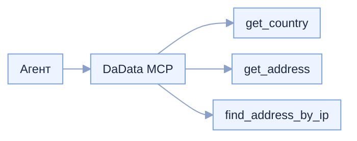

# DaData Local MCP

Локальный MCP-сервер на C#, .NET 8, работает по stdio.
MCP отдает агенту в Cursor три инструмента по API [DaData](https://dadata.ru/): страна по названию или коду, адрес по координатам, город по IP. **Это собственное решение в репозитории**, не облачный MCP с сайта DaData.




# Проверочные запросы и тестирование

Ключ в чат текстом не пишите — он вводится только в форме, которую сервер сам открывает при вызове tool.

## Запросы с вызовом tool


| #   | Запрос пользователя                     | Ожидаемый tool       |
| --- | --------------------------------------- | -------------------- |
| 1   | Какая страна имеет код «DE»?            | `get_country`        |
| 2   | Какой адрес у координат 55.878, 37.653? | `get_address`        |
| 3   | Какой город у IP 46.226.227.20?         | `find_address_by_ip` |
| 4   | Найди страну с кодом TH                 | `get_country`        |


Ожидаемые фрагменты лога MCP-сервера (stderr). На успешный вызов — одна строка `ToolCallLog`: аргументы tool и `status=success`. Тело POST в DaData и сырой JSON ответа в лог не пишутся.

```text
[get_country] params={"query":"DE","count":10} status=success
[get_address] params={"lat":55.878,"lon":37.653,"count":10,"radiusMeters":100} status=success
[find_address_by_ip] params={"ip":"46.226.227.20"} status=success
```


## Запрос без tool (для критерия «5 запросов»)


| #   | Запрос пользователя                                         | Ожидаемый tool                       |
| --- | ----------------------------------------------------------- | ------------------------------------ |
| 5   | Объясни, как IDE подключается к MCP-серверу Dadata по stdio | нет (ответ из README / общих знаний) |
| 6   | Покажи json с списком tools от MCP Dadata local             | запрос к локальному mcp              |


Итого: 5 запросов, где 4 с реальным вызовом MCP-tool.

## Как IDE подключается к MCP и что такое tool

Cursor запускает этот сервер как дочерний процесс и говорит с ним по **stdio**: JSON-RPC идёт через stdin/stdout, логи — только в stderr. При подключении IDE выполняет handshake (`initialize`), забирает метаданные сервера (`dadata-mcp` 1.0.0) и список tools. Дальше агент в чате может вызвать tool по имени: передаёт аргументы по JSON-схеме, сервер ходит в DaData и возвращает структурированный JSON.

**Tool** здесь — метод с атрибутом `[McpServerTool]`: понятное имя, описание, схема входных параметров и объектный результат. Три tool: `get_country`, `get_address`, `find_address_by_ip`. API-ключ в схему tool не входит и в аргументах не передаётся.

## API-ключ: форма в чате, без .env

Ключ DaData нигде на диске не хранится — ни в `.env`, ни в переменных окружения. Он живёт только в памяти процесса MCP. Источник ключа один — форма в чате Cursor (MCP elicitation, режим `form`).

При включении MCP форма **не** открывается: процесс стартует без ключа и просто ждёт вызовов. Форма открывается **при вызове любого tool** через `EnsureApiKeyAsync`, если в сессии нет живого ключа: это первый вызов в новом процессе, вызов после сброса сессии или после закрытой формы.

```mermaid
flowchart TD
    toolCall[Вызов tool] --> gate[EnsureApiKeyAsync]
    gate --> alive{Сессия жива и младше суток}
    alive -->|да| ready[Ключ уже есть]
    alive -->|нет| form[Форма в чате]
    form -->|accept| mem[В память сессии]
    form -->|decline/cancel| stop[Ключ не сохранён]
    ready --> call[Запрос в DaData]
    mem --> call
```


- Хранение — singleton в памяти процесса, TTL 24 часа. Вызов tool в последний час продлевает сессию ещё на 24 часа. Ни файла, ни базы, ни `.env`. В stderr при работе с ключом пишутся только служебные строки `[api-key] …` (запрос формы, принятие, отказ, таймаут, истечение, продление), без самого ключа.
- Заголовок `Authorization: Token …` ставится на каждый запрос из текущей сессии — после повторного ввода уходит уже новый токен.
- Сессия сбрасывается через 24 часа без продления, при HTTP 401 от DaData и при остановке процесса.
- Продление: если до конца сессии осталось не больше часа, вызов tool сдвигает срок на 24 часа от текущего момента. Срок проверяется лениво, при обращении к ключу.
- Если форму закрыли при вызове tool, ключ не сохраняется, вызов завершается коротким текстом ошибки без запроса в DaData, следующий вызов снова откроет форму.
- Параллельные вызовы без ключа ждут одну форму. Ожидание ответа формы (и очереди за чужой формой) ограничено 3 минутами: по таймауту вызов завершается ошибкой, следующий откроет форму заново.
- Сроки можно переопределить без пересборки (в `env` или аргументах запуска в `mcp.json`, ключ там не хранится): `DADATA_SESSION_TTL_MINUTES` (24 ч по умолчанию), `DADATA_SESSION_RENEW_MINUTES` (порог продления, 60 по умолчанию), `DADATA_FORM_TIMEOUT_SECONDS` (180 по умолчанию). Нужно, например, чтобы проверить истечение сессии за пару минут.


## Требования

- [.NET 8 SDK](https://dotnet.microsoft.com/download/dotnet/8.0)
- Аккаунт [DaData](https://dadata.ru/) с **API-ключом** (вводится в форме в чате, не в файлах)

Все три метода идут в [подсказки](https://dadata.ru/api/suggest/country/) (`suggestions.dadata.ru`): до 10 000 запросов в день бесплатно. Платный cleaner / стандартизация адреса не используется.

## Сборка

```bash
dotnet restore
dotnet build
```

Сборка обязательна до включения MCP: Cursor и Codex запускают уже собранный DLL через `dotnet exec`.

## Как включить в Cursor

1. Соберите проект: `dotnet build`.
2. Пример конфига MCP: `[.cursor/mcp.json.example](.cursor/mcp.json.example)`. Рабочий файл: `[.cursor/mcp.json](.cursor/mcp.json)`. Ключей в конфиге нет.
3. Cursor → **Settings → MCP**. Включите сервер. Форма при включении не открывается.
4. Вызовите любой tool (например, `get_country`): в чате откроется форма ввода API-ключа DaData. Ключ попадёт в память процесса на 24 часа. Если форму закрыть, она снова откроется при следующем вызове tool.
5. В чате агента проверьте, что видны tools `get_country`, `get_address`, `find_address_by_ip`. Проверочные запросы выше: `[readme.md](readme.md)`.


## Как включить в Codex

Codex подключает этот сервер отдельно от Cursor, через пользовательский файл `~/.codex/config.toml` (на Windows — `%USERPROFILE%\.codex\config.toml`). Образец блока — `[.codex/config.toml](.codex/config.toml)`: его нужно вписать в пользовательский файл. Запускайте Codex из корня репозитория, чтобы относительный путь к DLL совпал. Ключ DaData в `config.toml` не кладётся.

По умолчанию Codex ждёт старт MCP **10 секунд**. Холодный `dotnet exec` за это время может не успеть завершить handshake и отдать список tools. `startup_timeout_sec = 15` удлиняет ожидание, `required = true` делает сервер обязательным: сессия начинается после инициализации `dadata`, а если за 15 секунд процесс не поднялся — запуск завершается ошибкой.

`tool_timeout_sec = 180` совпадает с ожиданием формы ключа (3 минуты, `DADATA_FORM_TIMEOUT_SECONDS`). Стандартный лимит вызова tool в Codex — 60 секунд; при нём вызов обрывается, пока форма ещё открыта.

```toml
[mcp_servers.dadata]
command = "dotnet"
args = ["exec", "src/DadataMcp.Server/bin/Debug/net8.0/DadataMcp.Server.dll"]
startup_timeout_sec = 15
tool_timeout_sec = 180
required = true
```


## Безопасность

- API-ключ хранится только в памяти процесса (TTL 24 часа). Ни `.env`, ни переменных окружения, ни файлов. В исходниках, в `.cursor/mcp.json`, в `~/.codex/config.toml`, в аргументах tools и в логах stderr ключа нет.
- Единственный способ задать ключ — форма в чате (MCP elicitation, режим `form`). Агент ключ не видит и в промпт не получает.
- Tools не читают файлы диска и не запускают команды ОС. Область доступа — только HTTP к `suggestions.dadata.ru`.
- Логи пишут имя tool, входные параметры, `success` или `error` и при ошибке DaData — HTTP-статус. Ключа в логе нет.


## Tool outputs contract

Контракт результата задан типами в `[src/DadataMcp.Server/Models/ToolResults.cs](src/DadataMcp.Server/Models/ToolResults.cs)` (L1–L43). MCP сериализует объекты в JSON (camelCase), это не «просто текст».

### `get_country`

Вход: `query` (string, до 300 символов); опционально `count` (1–20, по умолчанию 10). Поиск по названию, цифровому коду, альфа-2 и альфа-3 ([документация](https://dadata.ru/api/suggest/country/)).

```json
{
  "suggestions": [
    {
      "value": "Таиланд",
      "code": "764",
      "alfa2": "TH",
      "alfa3": "THA",
      "nameShort": "Таиланд",
      "name": "Королевство Таиланд"
    }
  ],
  "message": null
}
```

Если совпадений нет: `suggestions` — пустой массив, `message` — «Страна по запросу не найдена.».

### `get_address`

Вход: `lat`, `lon`; опционально `count` (1–20, по умолчанию 10), `radiusMeters` (1–1000, по умолчанию 100).

```json
{
  "suggestions": [
    {
      "value": "г Москва, ул Сухонская, д 11",
      "unrestrictedValue": "127642, г Москва, ул Сухонская, д 11",
      "postalCode": "127642",
      "country": "Россия",
      "region": "г Москва",
      "city": null,
      "street": "ул Сухонская",
      "house": "11",
      "geoLat": "55.878",
      "geoLon": "37.653",
      "fiasId": "..."
    }
  ]
}
```


### `find_address_by_ip`

Вход: `ip` (IPv4 или IPv6).

```json
{
  "location": {
    "value": "г Краснодар",
    "unrestrictedValue": "350000, Краснодарский край, г Краснодар",
    "postalCode": "350000",
    "city": "г Краснодар"
  },
  "message": null
}
```

Если город не определён: `{ "location": null, "message": "Город по указанному IP определить не удалось." }`.

## Структура

```text
src/DadataMcp.Server/          MCP-хост, клиент DaData, tools, сессия ключа
.cursor/mcp.json              рабочий конфиг Cursor без секретов
.cursor/mcp.json.example      запуск через dotnet exec
.codex/config.toml            образец MCP для ~/.codex/config.toml
```

